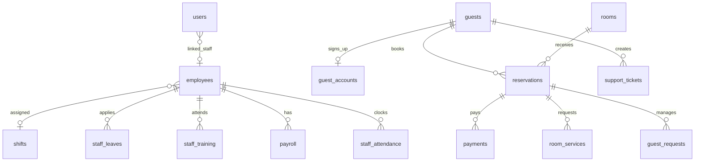

# STAYLINE GRAND — SQLite 資料庫與 API 設計

系統所有資料儲存於同一個 `stayline_grand.db`，並在執行 `server.init_db()` 時建立初始資料表，再由 `hotel_modules.init_extension()` 執行**加法遷移**：只新增新欄位、新表及預設班次，不刪除或重新初始化既有資料。SQLite 對每個請求開啟新連線並啟用 `PRAGMA foreign_keys=ON`；訂房、付款、申請審核等重要操作採用 `BEGIN IMMEDIATE` 交易避免競爭條件。

## 1. 資料表

| 資料表 | 主要欄位 | 關聯與用途 |
|---|---|---|
| `users` | `id,username,password_salt,password_hash,role,employee_id,created_at` | 管理員／員工帳號；首次建立的管理員 role=`admin`；`employee_id` 選填 |
| `rooms` | `id,number,room_type,floor,capacity,price,enabled,housekeeping,bed_type,description` | 房號唯一；標準、豪華、套房；清潔／待清潔／清潔中 |
| `guests` | `id,full_name,phone,email,document_no,notes` | 櫃檯與會員共用房客檔案 |
| `reservations` | `id,code,guest_id,room_id,check_in,check_out,adults,children,status,price_per_night,total_amount,source` | 連結 `guests` + `rooms`；`total_amount` 是房費快照，不包含服務費 |
| `payments` | `id,reservation_id,amount,method,note,paid_at` | 記帳用收款，信用卡並非真實金流 |
| `guest_accounts` | `id,guest_id,username,password_salt,password_hash` | 顧客會員，一個會員連至一筆房客資料 |
| `shifts` | `id,name,start_time,end_time` | 早班／中班／夜班及自訂班別 |
| `employees` | `id,full_name,position,department,phone,email,hire_date,status,shift_id` | 員工主檔，`shift_id` → shifts |
| `staff_leaves` | `id,employee_id,leave_type,start_date,end_date,notes,status` | 假單：待審核／核准／拒絕 |
| `staff_training` | `id,employee_id,title,training_date,outcome` | 員工培訓紀錄 |
| `staff_attendance` | `id,employee_id,work_date,clock_in,clock_out` | 每位員工每日一筆上下班打卡 |
| `payroll` | `id,employee_id,pay_period,amount,paid_on,note` | 每人每月一筆示範薪資記錄 |
| `room_services` | `id,reservation_id,kind,quantity,unit_price,note,status` | 服務單：顧客申請，員工完成時產生費用 |
| `support_tickets` | `id,guest_id,subject,message,reply,status` | 顧客聯繫客服，櫃檯回覆 |
| `guest_requests` | `id,reservation_id,request_type,status,staff_note,processed_at` | 顧客申請入住／退房，櫃檯核准後才會變更訂單 |

## 2. 核心關聯（ER diagram）

## 3. 關鍵規則

1. **撞期判斷**：已預訂、已入住的房間，若 `existing.check_in < new.check_out AND existing.check_out > new.check_in`，則無法再次預訂。已取消與已退房訂單不占用訂房庫存。
2. **房價快照**：訂單建立時將客房當時 `price` 保存成 `price_per_night` 與 `total_amount`，日後修改客房價格不回溯影響舊訂單。
3. **服務費**：只有 `room_services.status='completed'` 才加到應收總額：`bill_amount = reservations.total_amount + SUM(quantity*unit_price)`。任何收款不得超過尚未收取之金額。
4. **退房**：只接受已入住的訂單、且已收總額 `>= bill_amount`，完成後房間 `housekeeping` 設為 `dirty`。
5. **入住**：日期在預訂期間、房間已清潔且啟用、無其他正在入住的客人才能辦理。
6. **會員授權**：登入顧客只能讀取／修改其 `guest_accounts.guest_id` 關聯的預訂、客服和服務要求；不能自行選擇其他客人的 `guest_id`。
7. **員工權限**：管理員可管理薪資／帳號；櫃檯可處理訂房及顧客申請；房務僅能更改清潔狀態、處理房務服務與自己打卡。
8. **請假與培訓**：僅登記和管理資訊，尚未自動按班表計算可休天數或薪資扣減。

## 4. API 概覽

### 公共與顧客網站

| Method | URL | 說明 |
|---|---|---|
| GET | `/api/public/rooms?check_in=...&check_out=...` | 查詢空房（不需要登入） |
| POST | `/api/portal/register` / `/api/portal/login` | 顧客註冊／登入 |
| GET | `/api/portal/me` | 自己的顧客資料及 CSRF token |
| PUT | `/api/portal/profile` | 修改顧客聯絡資料 |
| GET / POST | `/api/portal/reservations` (GET) / `/api/portal/book` (POST) | 查看自己的訂單／建立訂房 |
| POST | `/api/portal/cancel` | 取消自己的未付款預訂 |
| GET / POST | `/api/portal/requests` | 查詢／新增入住退房申請 |
| GET / POST | `/api/portal/services` | 查詢／新增已入住客房服務單 |
| GET / POST | `/api/portal/tickets` | 查詢／新增客服工單 |
| GET | `/api/portal/payments` | 查看自己訂單的收款記錄 |
| POST | `/api/portal/logout` | 登出顧客 |

### 管理員與員工

| Method | URL | 說明 |
|---|---|---|
| GET | `/api/bootstrap`, `/api/me`, `/api/dashboard` | 系統狀態、使用者資料、營運統計 |
| GET/POST/PUT/DELETE | `/api/rooms`, `/api/rooms/:id` | 客房 CRUD（部分需權限） |
| GET/POST/PUT/DELETE | `/api/guests`, `/api/guests/:id` | 房客 CRUD |
| GET/POST/PUT | `/api/reservations`, `/api/reservations/:id` | 訂房管理 |
| POST | `/api/reservations/:id/check-in`, `/check-out`, `/cancel` | 櫃檯辦理入住／退房／取消 |
| GET/POST | `/api/payments` | 付款流水與登記 |
| GET | `/api/ops/overview` | 依角色回傳員工、工單、打卡資料 |
| POST/PUT | `/api/ops/employees`, `/api/ops/employees/:id` | 管理員新增／更新員工 |
| POST | `/api/ops/accounts` | 管理員為員工建立登入帳號 |
| POST | `/api/ops/shifts`, `/api/ops/leaves`, `/api/ops/training`, `/api/ops/payroll` | 建班次、請假、培訓、薪資 |
| PATCH | `/api/ops/leaves/:id` | 假單審核 |
| POST | `/api/ops/attendance/clock-in`, `/clock-out` | 員工上下班打卡 |
| PATCH | `/api/ops/services/:id` | 更新服務處理狀態 |
| PATCH | `/api/ops/requests/:id` | 櫃檯審核入住／退房 |
| PATCH | `/api/ops/tickets/:id` | 回覆客服 |
| PATCH | `/api/ops/rooms/:id/housekeeping` | 房務清潔狀態 |

## 5. 安全與部署界限

- HTTP 登入 Cookie 設為 `HttpOnly`, `SameSite=Strict`；寫入 API 使用 session CSRF token，並檢查請求來源；透過參數化 SQL 減少注入風險。
- 角色權限於**後端每個新模組**檢查，不只靠前端隱藏按鈕。
- 密碼以 PBKDF2-HMAC-SHA256 + 個別 salt 保存；會話僅在伺服器記憶體中，重啟需要重新登入。
- 未建立完整帳號復原／封鎖／稽核紀錄流程；不可直接對外網部署。
