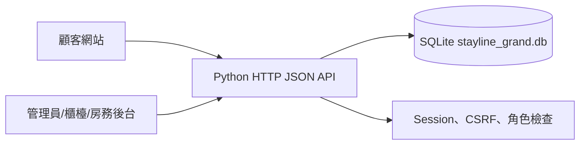

# STAYLINE GRAND — 資工系作品集展示指南

## 專題名稱
STAYLINE GRAND：具備旅客／櫃檯／房務／管理員角色的飯店管理系統。

## 靈感與需求來源
參考使用者提供的 SUNSET HEAVEN 飯店管理系統專題文件，選擇重新做一套 **Python + SQLite 的本機網頁版系統**；功能相近，但未採用其 Java/MySQL、原始 UI 資源，也不宣稱取得原作者程式碼。

## 系統解決的問題
- 旅客可自行查看房型與下訂，櫃檯同步看到訂單。
- 訂房日期撞期會拒絕，避免雙重預訂。
- 入住後的餐飲／洗衣服務計入帳單，尚未付清不可退房。
- 客房退房後需清潔，房務管理與櫃檯共用資料。
- 員工、班次、假單、培訓與薪資由管理員統一登記。

## 架構圖

## 關鍵演算法
1. 房間 A 訂房期間採用 `[入住日, 退房日)` 半開區間；若 `新入住日 < 已訂退房日 且 新退房日 > 已訂入住日`，就拒絕預訂。
2. 訂單建立時保存當時房價快照。計費為 `晚數 × 當時每晚房價 + 已完成的付費服務 - 已收款`。
3. 後端驗證每個角色可以讀取／修改哪些資料，顧客只能管理自己的訂單。

## 展示建議
- 先以顧客會員訂房，切換管理員看到訂單即時出現。
- 直接重複訂同一間房同日期，展示 API 阻擋撞期。
- 入住 → 客房服務 → 收款 → 退房 → 房務清潔，展示跨角色流程。
- 展示 `DATABASE_DESIGN.md` 的關聯與測試命令 `py -m unittest discover -s tests -v`。

## 已驗證的範圍
截至 2026-11-16，Python 端 10 項回歸與整合測試均通過。真實網路金流、Email、正式上線安全性、跨台電腦同步與大量負載未經實作或驗證。

## 作品集誠實聲明
這份程式由 AI 協作生成與測試；對外呈現時請描述自己親自參與的需求規劃、操作測試、閱讀程式、修改與學到的知識，不應宣稱全部獨立手寫。
